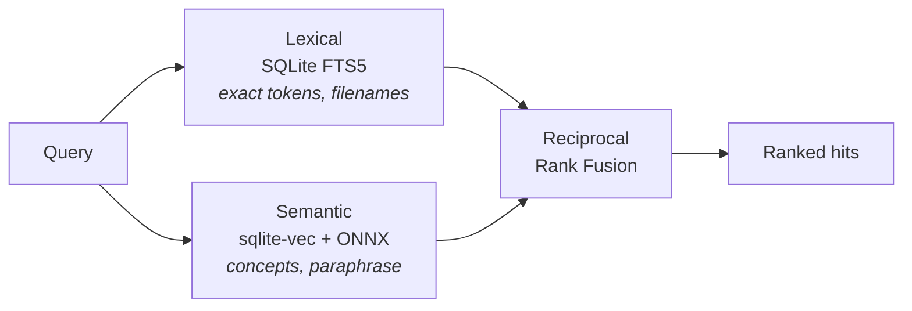

# forge-search

Local code and docs search over one or many repositories, served as an MCP
tool.

Point it at a directory and it works. Point it at several and it searches them
together, returning ranked excerpts with the project, relative path, and line
number. Everything runs on your machine; nothing is uploaded.

```bash
uv tool install 'forge-search[semantic]'
forge-search warm
forge-search search "how do tokens get validated" --root ~/code/api --semantic
```

```text
api/src/auth.py:42: def validate_token(token: str) -> Claims:
api/docs/sessions.md:18: ## Token lifetime and refresh
```

## Why it exists

It was built after auditing why repository search kept quietly returning
nothing. Four defects turned up, and all four were **silent** — zero results
rather than an error, which is indistinguishable from "the content does not
exist". A caller acts on the false negative with full confidence.

| Defect | Measured effect |
|---|---|
| Hidden directories skipped by default | **20 of 44 files invisible** — over half a real repository |
| Ignore rules applied to explicitly-named paths | A directory passed by name returned **zero hits** |
| Line-length limits replacing the match with a placeholder | The matched text **destroyed**, not shortened |
| Absolute index roots going stale on move or re-clone | Server fails to launch; **every search silently returns nothing** |

Each is fixed as a **default**, not an option — because every one was already
fixable by passing the right flag, and nobody did. Correctness that depends on
remembering a flag is not correctness.

That principle runs through everything here: a malformed query raises instead
of returning an empty list, an unreadable root is reported instead of dropped,
and an index built by a different model discards itself instead of returning
confident nonsense. The full record, including six more bugs of the same shape
found while building it, is in [docs/decisions.md](docs/decisions.md).

## Install

```bash
uv tool install forge-search              # lexical search
uv tool install 'forge-search[semantic]'  # + semantic (adds an embedding model)
```

Latest from source:

```bash
uv tool install --upgrade --force "forge-search[semantic] @ git+https://github.com/mohamed-rekiba/forge-search"
```

Requires Python 3.14+. No compiler — both native dependencies ship prebuilt
wheels for cp314.

> Note the **brackets**. `--with semantic` installs an unrelated PyPI package
> that happens to be named `semantic`, leaving the arm dead with
> `No module named 'onnxruntime'`.

## Use

```bash
# One-shot search — the fastest way to check behaviour
forge-search search "validate_token" --root /abs/path/to/project
forge-search search "require-active-ticket" --root api=~/code/api --top-k 5
forge-search search "authentication" --root ~/code/api --docs   # prose only

# Build indexes without serving
forge-search index --root api=~/code/api

# Run as an MCP server
forge-search serve --root api=~/code/api --semantic
```

**`--root` is required. Nothing is discovered.** No walk-up, no
working-directory inference, no marker sniffing, no fallback guess — inferring
a root wrongly is silent, and every search afterwards returns plausible
results from a tree you did not ask about.

## Register with an MCP client

Add to `.mcp.json` in your project, with an **absolute path**:

```json
{
  "mcpServers": {
    "forge-search": {
      "type": "stdio",
      "command": "forge-search",
      "args": ["serve", "--root", "/absolute/path/to/project", "--semantic"]
    }
  }
}
```

Tools appear as `mcp__forge-search__search_code`, `…__search_docs`, and
`…__reindex`.

For an apexyard fork, point one server at the portfolio instead of a single
project. `--adapter apexyard` reads the roots from `apexyard.projects.yaml`, and
`--name` sets the tool prefix:

```json
{
  "mcpServers": {
    "apexyard-search": {
      "type": "stdio",
      "command": "forge-search",
      "args": [
        "serve", "--root", "/absolute/path/to/your/apexyard/fork", "--semantic",
        "--name", "apexyard-search", "--adapter", "apexyard"
      ]
    }
  }
}
```

The root must be the ops fork itself. The adapter starts there to find the
registry, whether it sits in the fork or, in split-portfolio mode, in the private
sibling repo the fork's config points at. Give it as an absolute path: a relative
one resolves against the client's
working directory, and when the adapter finds no registry there it falls back to
treating that directory as a single root — which searches successfully and
silently omits the rest of the portfolio.

A project registered after the server started does not need a restart. The first
request naming it re-resolves the root set, and it stays visible for
search-everything requests after that.

Avoid `${workspaceFolder}` — it is a VS Code `launch.json` variable that MCP
clients do not agree on. It is accepted as a fallback, but see
[docs/troubleshooting.md](docs/troubleshooting.md#workspacefolder-appears-literally-in-an-error).

## How it searches

Two arms answer different questions, fused by rank.



Measured on a 26-query fixture, mostly conceptual, over a real repository:

```text
mode         recall      p50 ms
lexical      11.5%        0.5
semantic     61.5%        4.9
hybrid       61.5%        6.1
```

Hybrid is the default: it never loses the exact identifier matches BM25 gets
for free. The semantic arm needs `--semantic` plus a one-time
`forge-search warm` — without it you are on lexical only, and conceptual
queries return nothing at all.

Details: [docs/searching.md](docs/searching.md).

## Tools

| Tool | Purpose |
|---|---|
| `search_code(query, project=None, top_k=10)` | Full-text across contents **and** filenames |
| `search_docs(query, project=None, top_k=10)` | The same, restricted to `.md` / `.rst` / `.txt` |
| `reindex(project=None, force=False)` | Rarely needed — searches detect staleness themselves |

Queries are matched **literally**: hyphens, dots, and slashes in identifiers
and paths are searched as written, not parsed as operators. Prefix with
`fts5:` for expression syntax (`NEAR`, `OR`, prefix matching).

Responses carry `degraded` (roots that could not be read — reported, never
dropped, so a partial answer never looks complete) and `reindexed` (roots
refreshed during the call).

## Indexes

One SQLite file per root, in `<root>/.forge_search/`, beside the code so it
lives and dies with the project. The directory ships a `.gitignore` containing
`*`, so it ignores itself — nothing to remember, invisible to `git status`.

Every search stats each indexed file and reindexes on mismatch. Delegating
that to a human is a convention, and conventions nobody follows produced every
defect above.

An absolute `--index-dir` opts back into a single shared directory for trees
you cannot write to. Details: [docs/indexing.md](docs/indexing.md).

## Documentation

| Document | What's in it |
|---|---|
| [docs/architecture.md](docs/architecture.md) | How the pieces fit, the module map, the adapter seam |
| [docs/indexing.md](docs/indexing.md) | Traversal, schema, freshness, chunking, staleness guards |
| [docs/searching.md](docs/searching.md) | The two arms, fusion, reranking, query syntax, the tools |
| [docs/configuration.md](docs/configuration.md) | Every flag, index location, adapters, transports |
| [docs/troubleshooting.md](docs/troubleshooting.md) | Real failures and what caused them |
| [docs/decisions.md](docs/decisions.md) | Why it is shaped this way, including reversals |
| [BENCHMARK.md](BENCHMARK.md) | Numbers, method, and honest limits |
| [CONTRIBUTING.md](CONTRIBUTING.md) | Dev workflow and the silent-failure checklist |

## Is the semantic arm worth it?

`bench` answers with a number rather than an opinion, and is written so the
unflattering answer is as easy to reach as the flattering one:

```bash
forge-search bench --root /abs/path --fixture bench/apexyard.txt --semantic
```

Every fixture line names the file that *should* be found, so modes are
compared at **equal answer-recall**. Without that control a mode "wins" on
tokens by returning less — which is losing, more cheaply.

`verdict()` will say *"pure overhead — remove the arm"* as readily as the
opposite; five tests exist solely to keep it willing to. If it says the
semantic arm earns nothing on your corpus, set `ArmWeights(semantic=0.0)` — no
release needed — and if that holds, delete the arm rather than carrying it.

## Licence

MIT
