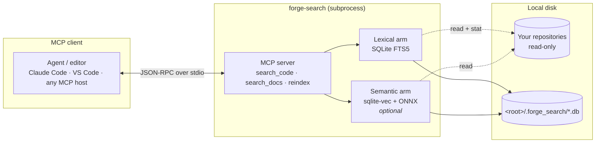
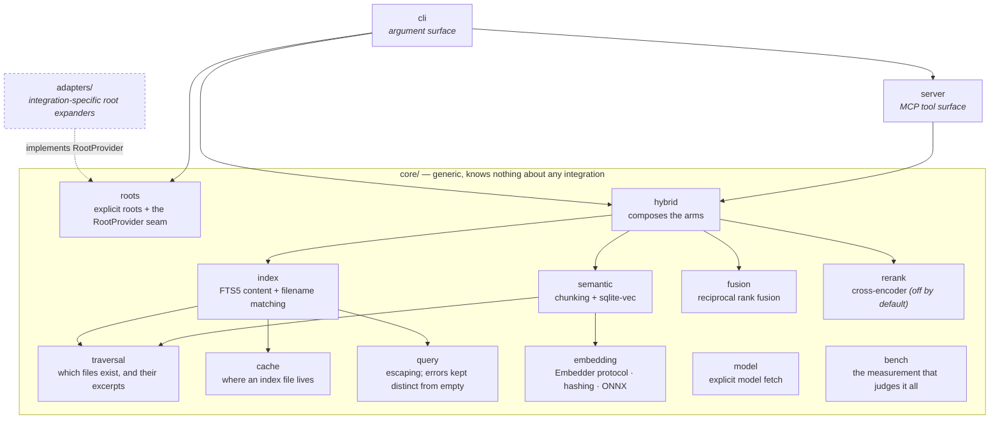
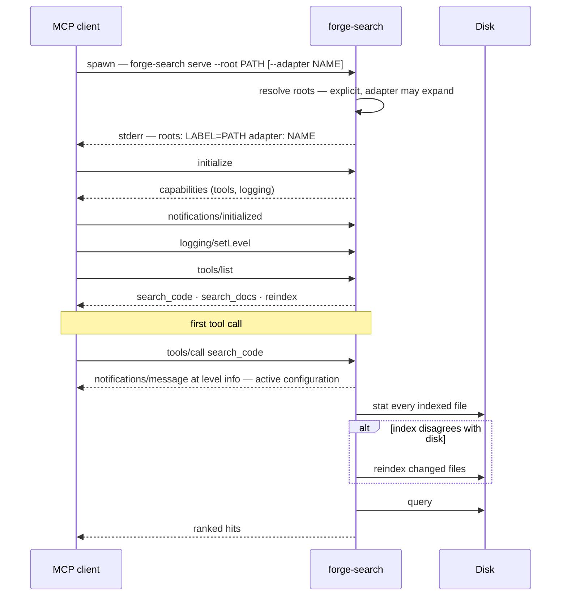

# Architecture

forge-search indexes one or more directory trees into SQLite and serves search
over them as MCP tools. There is no server process to manage, no daemon, no
network service, and no external index — a stdio server is a subprocess your
editor starts and stops, and the index is a file.

## Where it sits



Everything runs locally. Nothing is uploaded, and the only network access is
one explicit `forge-search warm` to fetch the embedding model — never during a
search.

## Modules



Two rules hold this shape:

**`core/` never imports `adapters/`.** The dependency points one way. A test
asserts it, by checking imports rather than word occurrences, because the
first version of that test passed while a `core/` docstring cheerfully
mentioned `--adapter apexyard`.

**`hybrid` composes the arms so neither imports the other.** `index` knows
nothing about embeddings; `semantic` knows nothing about FTS5. Either can be
absent — a lexical-only install never imports `semantic` at all — and the
composition layer is the only place that has to care.

## The adapter seam

An adapter is a root **expander**, not a root discoverer. It receives a root
the caller already named, decides whether it understands that shape of tree,
and if so expands it into the several labelled roots it really contains.

```python
class RootProvider:
    name: str = ""                      # what `--adapter <name>` selects
    index_dir: str | None = None        # optionally moves the default index location

    def expand(self, root: Root) -> Sequence[Root]:
        return [root]
```

That is the entire interface. It is narrow on purpose: anything wider lets
integration concepts into the core, at which point "works standalone" becomes
a claim in a README rather than a property of the code.

**Adapters are named, never detected.** An adapter that enables itself because
it spotted a marker file can fire when you did not want it and stay silent
when you did — both invisibly. Naming it costs one flag and removes the
failure class entirely. See [decisions.md](decisions.md#nothing-is-discovered).

## Startup



The configuration is reported twice on purpose — once on stderr, once as an
MCP log notification — because clients differ in which they surface. See
[troubleshooting.md](troubleshooting.md#i-cannot-see-which-root-is-being-searched).

## Design constraints worth knowing

**Read-only against your repositories.** The only thing written inside a
searched tree is `<root>/.forge_search/`, which ships a `.gitignore`
containing `*` so it ignores itself.

**No background work.** Nothing runs between requests. Freshness is checked
during a search, not by a watcher — see
[indexing.md](indexing.md#freshness).

**Failures are loud.** A query that cannot be parsed raises rather than
returning an empty list; a root that does not exist aborts startup with a
message naming the fix; an index built by a different model discards itself.
This is the project's whole thesis, and it is
[the reason it exists](decisions.md#why-this-exists).

---

Next: [indexing.md](indexing.md) · [searching.md](searching.md) ·
[configuration.md](configuration.md)
