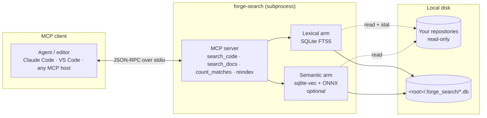
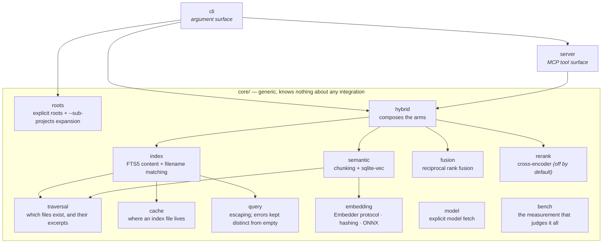
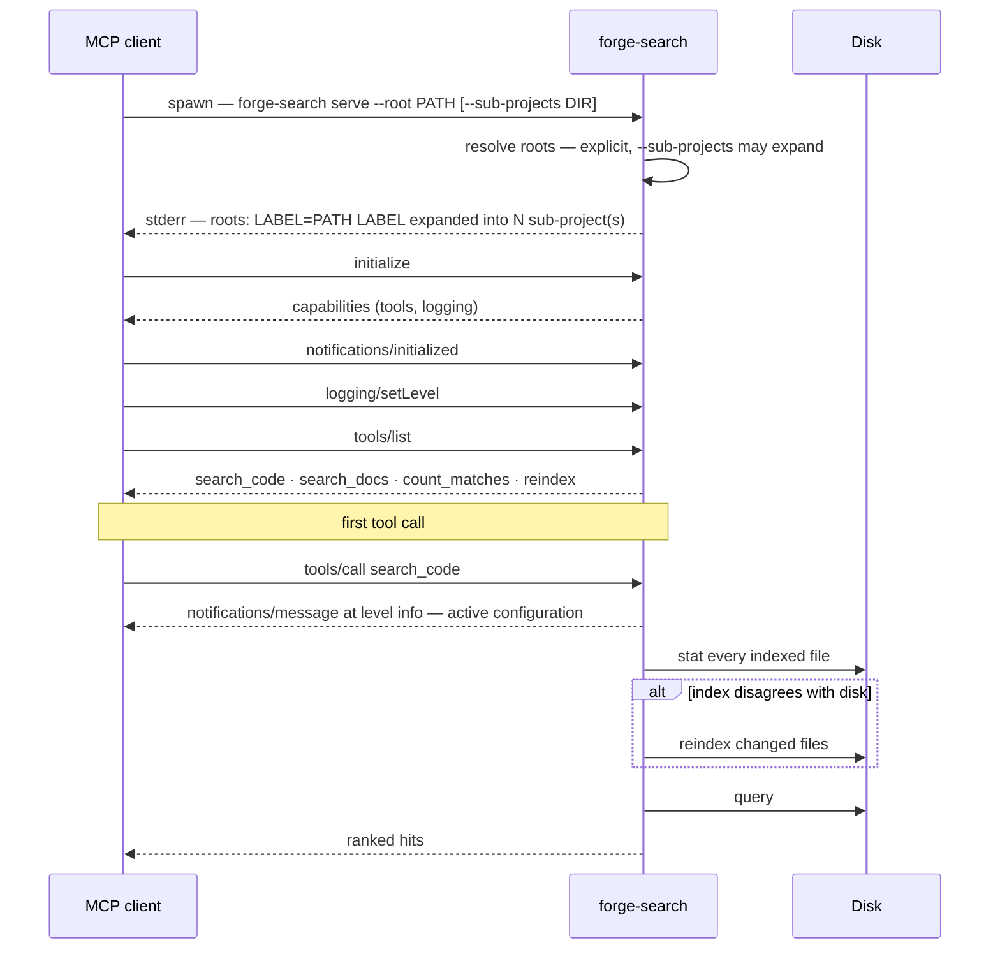

# Architecture

forge-search indexes one or more directory trees into SQLite and serves search
over them as MCP tools. There is no server process to manage, no daemon, no
network service, and no external index — a stdio server is a subprocess your
editor starts and stops, and the index is a file.

## Where it sits



Everything runs locally. Nothing is uploaded, and the only network access is
one explicit `forge-search warm` to fetch the embedding model — never during a
search.

## Modules



One rule holds this shape:

**`hybrid` composes the arms so neither imports the other.** `index` knows
nothing about embeddings; `semantic` knows nothing about FTS5. Either can be
absent — a lexical-only install never imports `semantic` at all — and the
composition layer is the only place that has to care.

## Sub-project expansion

`--sub-projects` turns one named root into the several roots it really
contains. A directory named by the flag is resolved relative to the root,
scanned for checkouts — anything containing `.git` — and each one becomes an
additional labelled `Root`.

```python
def resolve_roots(
    given: Iterable[Root],
    *,
    sub_projects: Sequence[str] = (),
) -> Resolution: ...
```

This used to be a `RootProvider` seam: a class the caller selected by name
(`--adapter apexyard`), which read a portfolio's own config files to infer
the same structure a flag now states directly. Removing that class is not
core learning a new trick — it is core doing what it already claimed to do
("everything explicit, nothing discovered") without the one exception that
contradicted it. See [decisions.md](decisions.md#nothing-is-discovered) and
the entry recording the seam's removal.

## Startup



The configuration is reported twice on purpose — once on stderr, once as an
MCP log notification — because clients differ in which they surface. See
[troubleshooting.md](troubleshooting.md#i-cannot-see-which-root-is-being-searched).

## Design constraints worth knowing

**Read-only against your repositories.** The only thing written inside a
searched tree is `<root>/.forge_search/`, which ships a `.gitignore`
containing `*` so it ignores itself.

**No background work.** Nothing runs between requests. Freshness is checked
during a search, not by a watcher — see
[indexing.md](indexing.md#freshness).

**Failures are loud.** A query that cannot be parsed raises rather than
returning an empty list; a root that does not exist aborts startup with a
message naming the fix; an index built by a different model discards itself.
This is the project's whole thesis, and it is
[the reason it exists](decisions.md#why-this-exists).

---

Next: [indexing.md](indexing.md) · [searching.md](searching.md) ·
[configuration.md](configuration.md)
