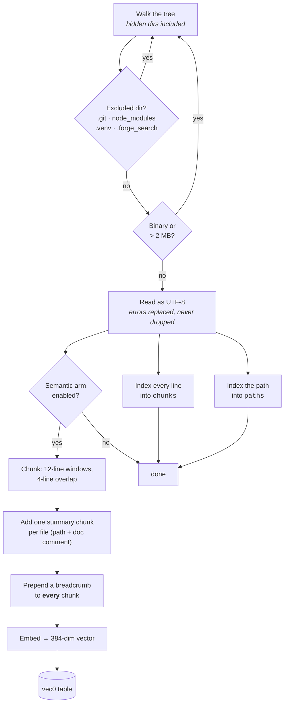
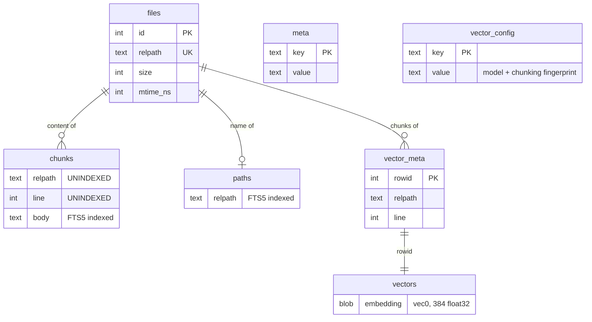
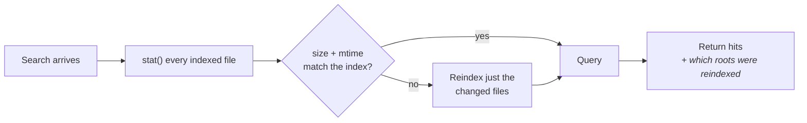

# Indexing

How files become something searchable, where that lands, and how it stays
honest as the tree changes.

## The pipeline



## What gets walked

Hidden directories **are** traversed. This is deliberate and is one of the four
defects the project was built to fix: skipping them by default made 20 of 44
files invisible in a real repository — over half of it — and returned zero
results rather than an error.

Skipped by default (`DEFAULT_EXCLUDES`): `.git`, `.hg`, `.svn`,
`node_modules`, `.venv`, `venv`, `__pycache__`, `.mypy_cache`,
`.pytest_cache`, `.ruff_cache`, `.tox`, and `.forge_search` / `.forge-search`
— the last two so an index can never index itself.

Files over 2 MB and files that do not decode as text are skipped. Decoding
uses `errors="replace"`, so a file with one bad byte is indexed with that byte
replaced rather than dropped entirely.

## Two lexical tables, because they answer different questions



`paths` exists because **a file frequently does not contain its own name.**
Searching `require-active-ticket` should find `require-active-ticket.sh` even
though that file never mentions itself — a content-only index cannot do it at
all. Two files in the source corpus were unfindable by name before this table
existed.

A filename match scores `1000.0`, far above any BM25 score, because someone
searching `auth.py` wants that file rather than the tests that mention it.

## Freshness



Every search compares the index against the filesystem — one `stat` per
indexed file — and reindexes if they disagree. On a 700-file tree that is
single-digit milliseconds.

This is deliberate, and the alternative was tried. Delegating freshness to a
human or an agent ("remember to reindex after editing") is a convention, and
conventions nobody follows are what produced every defect in this project's
history. A stale index has the same shape as all of them: plausible results,
no error, nothing that announces the problem.

Reindexing is incremental — only files whose size or mtime changed are
re-read. The response reports which roots were refreshed, so a slow first
query after a big rebase is explained rather than mysterious.

## Staleness guards

Two things invalidate an index wholesale rather than incrementally.

**Schema version** (`SCHEMA_VERSION`, currently 8). When it changes, the index
is discarded and rebuilt rather than migrated in place. Blunt on purpose: a
targeted migration that misses one table leaves the index looking healthy
while silently missing a capability — a failure this project has shipped
twice.

The guard clears **unconditionally** on mismatch, including when no version is
stored at all. An unstamped index is a pre-versioning index, which is exactly
the case that needs rebuilding; an earlier version skipped the clear when
nothing was stored, stamped the current version onto stale data, and made the
gap permanent.

**Model + chunking fingerprint** (`vector_config`). Embeddings are only
comparable to other embeddings from the same model and the same chunking.
Reused across a change, the result is cosine distance between two unrelated
vector spaces — confident nonsense, no error. `dim` cannot stand in for
identity: `all-MiniLM-L6-v2` and `multi-qa-MiniLM-L6-cos-v1` are both
384-dimensional.

This was not hypothetical. Rebuilding a polluted index and re-running the same
fixture moved semantic recall from 50.0% to 61.5%; see
[BENCHMARK.md](../BENCHMARK.md).

## Chunking for the semantic arm

Fixed 12-line windows with 4 lines of overlap, plus one summary chunk per file
built from its path and leading doc comment.

Then the part that mattered more than everything else combined: **every chunk
is prefixed with a breadcrumb** — `path > heading` for markdown,
`path > function` for code.

| Chunking | semantic recall | hybrid recall |
|---|---:|---:|
| Sliding windows, no context | **0.0%** | 25.0% |
| \+ summary chunk per file | 50.0% | 62.5% |
| \+ breadcrumb on every chunk | **87.5%** | **87.5%** |

Same corpus, same model, same queries — only the chunking changed. Context is
the dominant variable by a wide margin, and the mechanism is measurable: a
header comment alone scores 0.484 against its target query, the 12-line window
containing it scores 0.368 (mean-pooling dilutes the signal by 24%), and
path + header scores 0.520.

This is the deterministic, no-LLM form of *contextual retrieval* — the
published technique generates per-chunk context with an LLM and reports a
35–49% reduction in retrieval failures.

Structure-aware chunking (splitting on function and heading boundaries) is
implemented and **off by default** because it measured 12.5 points worse here.
See [decisions.md](decisions.md#priors-that-lost-to-measurement).

## Where the index lives

`<root>/.forge_search/<label>.db` by default — beside the code, so it lives
and dies with the project.

```text
your-project/
  .forge_search/
    your-project.db
    .gitignore        ← "*", so the directory ignores itself
```

The alternative — a shared OS cache directory — is one flag away and is still
right for trees you cannot write to:

```bash
forge-search serve --root /abs/path --index-dir ~/.cache/forge-search
```

A relative `--index-dir` is per root; an absolute one is shared, and there the
filename regains a path hash because one directory holding many roots cannot
tell two projects that share a label apart.

Full rationale for the default, including why it was reversed:
[decisions.md](decisions.md#indexes-live-in-the-tree).

## Known limitation

The lexical index is token-based. A long unbroken run of characters — minified
JavaScript, a base64 blob — is a single token, so searching for a substring
inside it finds nothing. This is correct for the workload it targets
(identifiers, filenames, short phrases) and is pinned by a test so it stays
deliberate. Substring search over such content would need a trigram index.

---

Next: [searching.md](searching.md) · [configuration.md](configuration.md)
