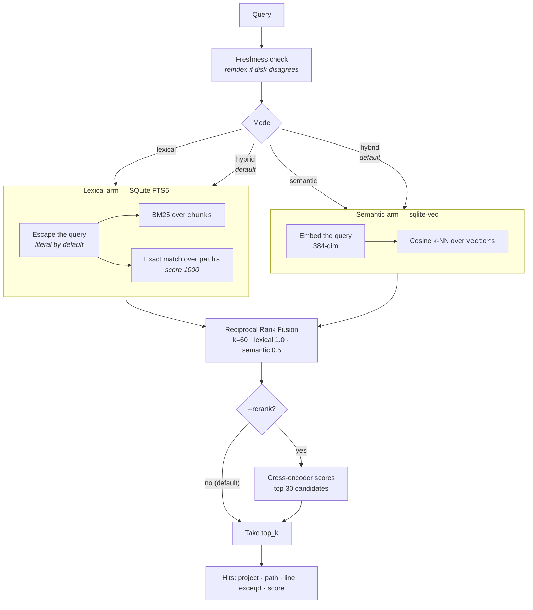

# Searching

Two arms answer different questions. One finds the token you typed; the other
finds the idea you meant. Fusion decides the order.

## The pipeline



Both arms over-fetch (`top_k × 3`) before fusion. Fusing two already-truncated
top-10 lists would mostly reproduce them; reordering only has room to matter
with more candidates than you intend to return.

## Why two arms

| | Finds | Misses |
|---|---|---|
| **Lexical** (BM25 + filename) | Exact identifiers, paths, error strings, anything you can spell | Anything phrased differently from the source |
| **Semantic** (embeddings) | Concepts, questions, paraphrase | Exact tokens it happens not to rank highly |

Measured on a 26-query fixture over this project's own governing repository:

```text
mode         recall      p50 ms
lexical      11.5%        0.5
semantic     61.5%        4.9
hybrid       61.5%        6.1
```

The queries are mostly conceptual — *"how do I know if a merge is allowed"* —
which is where lexical collapses. On identifier lookups the ordering reverses.
Hybrid is the default because it never loses the exact matches BM25 gets for
free.

## Fusion

Reciprocal Rank Fusion: each arm contributes `weight / (k + rank)` for every
result it returned, and the sums decide the order.

```text
score(doc) = Σ  weight_arm / (60 + rank_in_that_arm)
```

RRF uses **ranks, not scores**, which is the whole point — BM25 scores and
cosine similarities live on incomparable scales, and any attempt to normalise
them into each other invents a relationship that isn't there. Rank is the one
thing both arms genuinely agree on the meaning of.

`k=60` is the value from the original RRF paper and is not tuned here.
Weights default to lexical `1.0`, semantic `0.5` — the semantic arm is a
tie-breaker and recall-widener, not an equal vote.

When one arm returns nothing, fusion degrades to exactly the other arm's
order. A lexical-only install produces byte-identical results to running the
lexical arm alone.

## Query syntax

Queries are matched **literally**. Hyphens, dots, slashes, and parentheses in
identifiers and paths are searched as written, not parsed as operators.

```bash
forge-search search "require-active-ticket" --root /abs/path
forge-search search "core/index.py" --root /abs/path
```

This is not cosmetic. `require-active-ticket` reached FTS5 as an expression,
raised `no such column: active`, and the error was caught and returned as an
empty list — a valid query with real matches present, returning zero results,
silently. Escaping is now explicit, and a malformed query **raises** rather
than returning an empty list, because "no results" and "your query was
invalid" must never look the same.

For full-text expression syntax, opt in with a prefix:

```bash
forge-search search "fts5:auth NEAR/5 token" --root /abs/path
forge-search search "fts5:valid*" --root /abs/path
```

## Reranking (optional, off by default)

A cross-encoder scores query and candidate **jointly**, which a bi-encoder
structurally cannot — it embeds them separately and never sees the pair. The
literature reports this as the largest single-stage gain in retrieval.

It did not reproduce here:

```text
mode        recall (off → on)     p50 ms (off → on)
lexical     11.5%  →  11.5%          0.6  →   0.2
semantic    50.0%  →  50.0%          5.2  →  61.9
hybrid      57.7%  →  50.0%          6.6  →  59.5
```

Neutral on both single arms, and it actively demoted two answers RRF had
already ranked correctly, at roughly 10× the latency. So it ships behind a
flag, off, with a test pinning the default.

```bash
forge-search warm --reranker          # fetch the model, once
forge-search serve --root /abs/path --semantic --rerank
```

Try it on your corpus — these results are corpus-specific, and the flag exists
precisely because they might not hold for you. Full analysis, including two
bugs found while measuring it, in [BENCHMARK.md](../BENCHMARK.md).

## The MCP tools

### `search_code(query, project=None, top_k=10)`

Full-text search across all roots, or one named root. Searches both file
contents and filenames.

```json
{
  "results": [
    {"project": "api", "path": "src/auth.py", "line": 42,
     "excerpt": "def validate_token(token):", "score": 9.5}
  ],
  "truncated": false,
  "degraded": null,
  "reindexed": null
}
```

`degraded` lists roots that could not be read — **reported rather than
dropped**, so a partial answer never looks complete. `reindexed` names roots
refreshed during the call.

### `search_docs(query, project=None, top_k=10)`

The same, restricted to prose: `.md`, `.markdown`, `.rst`, `.txt`.

### `count_matches(query, project=None, docs_only=False)`

Every match, as `total_chunks`, `total_files`, and a file roster carrying a
per-file count — **no excerpts**.

`search_code` returns a ranked page and is capped, because excerpts are what
cost tokens. That cap leaves two ordinary questions unanswerable, since a
clipped page and a complete one look identical from outside:

- *What are all the call sites of this symbol?* — the blast radius of a rename.
- *Does this appear anywhere at all?* — `total_chunks == 0` on a fresh index is
  usable evidence, where an empty ranked page never was.

Completeness is affordable here precisely because nothing textual comes back: a
path costs a fraction of an excerpt, so the full answer is typically cheaper
than one page of the ranked one.

`docs_only` restricts the **totals**, not merely the listed files.

Lexical and literal — it does not consult the semantic arm, which ranks by
similarity and therefore has no complete match set to count.

An unparseable query raises rather than returning zero. That distinction is the
whole basis for reading a zero as absence.

### `reindex(project=None, force=False)`

Rarely needed — searches detect staleness themselves. Use `force` after
changing traversal settings.

## Measuring it yourself

```bash
forge-search bench --root /abs/path --fixture bench/apexyard.txt --semantic
```

A fixture is one `query::expected/path` per line. Naming the expected answer
is not optional: token counts are trivially improved by returning less, so a
mode that halves its output by dropping the answer has not won. Every
comparison is at **equal answer-recall**.

`verdict()` is written to reach the unflattering conclusion as readily as the
flattering one — it will say *"pure overhead — remove the arm"* and *"hybrid
is WORSE than lexical"*, and five tests exist solely to keep it willing to.

---

Next: [configuration.md](configuration.md) ·
[troubleshooting.md](troubleshooting.md)
